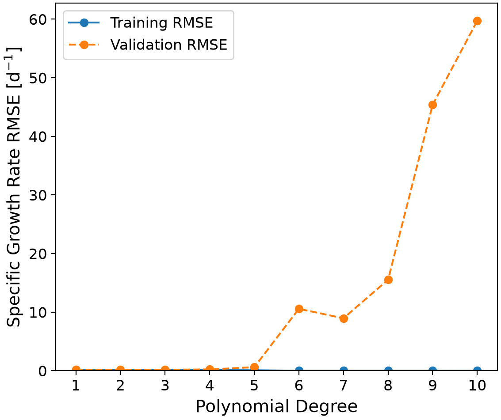
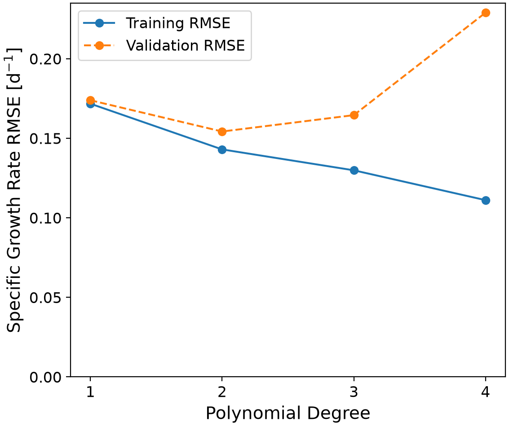
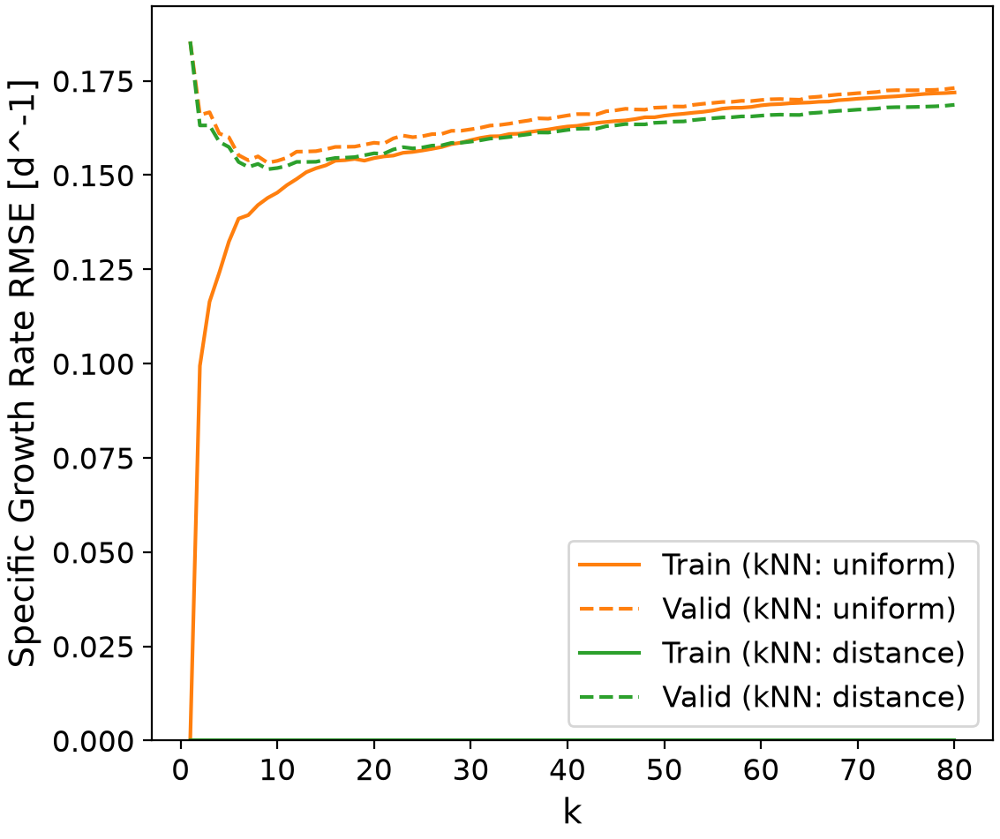
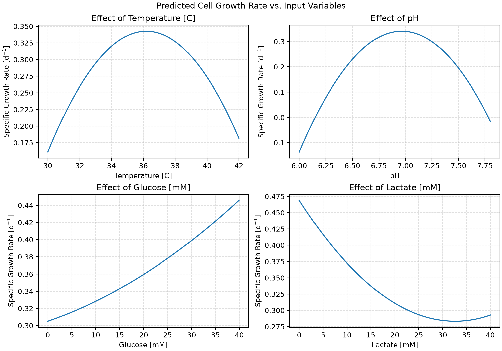

# Predicting Specific Cell Growth Rates Using a Fitted Second-Order Polynomial Model
When main.py is run, a predictive machine-based learning model is created and optimized based on standardized error, ease of understanding, and optimized parameters. Several models are evaluated, including parametric and non-parametric models, with relative errors and model specifications ranked to find the best model.  

## Highlights
-Processed data from cell culture process using Python and Pandas
-Developed Polynomial regression and k-Nearest Neighbours models
-illustrated validation and learning curves for prospective models
-Evaluated performance metrics, prioritizing accuracy and simplicity
-Optimized fitted model to predict cell growth rates

## Environment
-Python (version 3.14.7) 
-matplotlib (version 3.11.0) 
-numpy (version 2.5.2) 
-pandas (version 3.0.5) 
-scikit-learn (version 1.9.0)

## Workflow 
This workflow uses a machine learning pipeline to simplify the code by organizing the preprocessing and feature engineering steps. This pipeline uses the following structure: the data is split, the pipeline objects are instantiated, the target values are predicted, and the evaluation metrics are calculated. 
### Data Loading
The data was imported using pd.read_csv, which loads the provided CSV data file into a two-dimensional Pandas DataFrame, and os.path.join, which combines the file directory into a single path. The features and targets are separated based on their position in the dataset. The CSV file contains cell culture measurements. The first column is the target value, specific cell growth. The remaining four columns are the input features, comprised of temperature, pH, and glucose and lactate concentrations. The target and feature columns are then converted to NumPy arrays so that they can be interpreted by scikit-learn to train the regression models.  
### Preprocessing
The data is first split into its training and testing sets, using the train_test_split function. The training set accounts for 80% of the total dataset, while the testing set accounts for the remaining 20%. To ensure replicability when the code is rerun, random_state=0 is chosen. 
The data is then standardized using StandardScalar so that it is all on the same scale. This model uses four independent features with different units [°C, pH, mM]; because a k-Nearest Neighbour model is evaluated, this standardization is especially important as the model relies on the distance between points. If the model were not standardized, features with larger magnitudes could have a disproportionate impact on the nearest neighbour estimates. 
### Feature Engineering
From the pipeline, PolynomialFeatures generates the independent and interactive terms between the input variables, allowing for the capture of combined and non-linear effects in the model. 
For k-Nearest Neighbours, the target value is predicted by locating the distance to the k-nearest neighbouring points, with either distance-based or uniform weighting. Uniform weighting gives equal influence to each point, while distance-based weighting scales the points’ weights based on the relative distance to the target value. The values of the neighbouring points are then used to calculate the expected target. 
### Model Training
Firstly, polynomial regressions were evaluated. The degree or order of the polynomial is varied from 1 to 10 to determine an appropriate model complexity. Next, the k-Nearest Neighbours model was evaluated. The number of neighbours was varied from 1 to 80. 
Both model types were ranked based on the average score and standard deviations of both the training and test data. The rankings for the polynomial models are exported to the following respective datasets, in the dataset folder: rank_test_poly and rank_test_knn. This was done with a GridSearchCV function, which optimizes the model over a cross-validated grid search. This is also referred to as hyperparameter optimization of the model. The training data is split into four cross-validation folds, with three being used for training and the remaining fold for validation. The negative RMSE is evaluated. The model with the highest negative RMSE is deemed to be the best model. 
Using cross-validation offers a more robust choice than a single train-test split, as the model performance is evaluated over multiple data folds, reducing the metric’s dependence on a single split. 
Validation curves are used as well to illustrate the optimal model choice. These figures are exported to the figure tab, under figure_01_validation_curve_poly.png and figure_02_validation_curve_knn.png, respectively. 

## Analysis
### Final Model Choice
The final model choice is a second-order polynomial regression model. This model is fairly simple, with a relatively small RMSE. 
The rankings of the mean score and standard deviations are shown in Tables 1 and 2 for the polynomial and k-nearest neighbour regressions, respectively. (Note: for ease of reading, only the first 15 scores are shown for the k-nearest neighbours regression)

#### Table 1: Polynomial Regression Score Rankings
|rank_test_score|param_polynomialfeatures__degree|mean_test_score     |std_test_score      |mean_train_score       |std_train_score      |
|---------------|--------------------------------|--------------------|--------------------|-----------------------|---------------------|
|1              |2                               |-0.1542291364059797 |0.010392561716728454|-0.14298377333173282   |0.0038605116438597173|
|2              |3                               |-0.16452155132164392|0.01797391227577359 |-0.1298533552341837    |0.003531327950970784 |
|3              |1                               |-0.17387851917345115|0.008007540752697639|-0.17170265519478153   |0.002839996243913902 |
|4              |4                               |-0.22891394889404848|0.058012214128649243|-0.11109671548177341   |0.005352151069102724 |
|5              |5                               |-0.6042549009766729 |0.08803074746934232 |-0.08334920738405449   |0.005327514498004378 |
|6              |7                               |-8.949106742438975  |1.6195680841824074  |-7.55160967003222e-14  |3.334204941517428e-14|
|7              |6                               |-10.567762361907846 |1.997877333463443   |-4.7329358936085013e-14|7.723943105745999e-15|
|8              |8                               |-15.530041050847595 |4.850914716711789   |-1.5318178083976994e-13|4.143974504183222e-14|
|9              |9                               |-45.40611451407399  |8.567836378191775   |-0.0008225384126510371 |0.001424678320849629 |
|10             |10                              |-59.72740297708877  |13.755646614842835  |-0.014499918045833001  |0.007357008545293262 |

#### Table 2: k-Nearest Neighbours Score Rankings
|rank_test_score|param_kneighborsregressor__n_neighbors|param_kneighborsregressor__weights|mean_test_score     |std_test_score         |mean_train_score     |std_train_score      |
|---------------|--------------------------------------|----------------------------------|--------------------|-----------------------|---------------------|---------------------|
|1              |9                                     |distance                          |-0.15154949304542978|0.011232894347816698   |0.0                  |0.0                  |
|2              |10                                    |distance                          |-0.15186947346546603|0.011076374829092921   |0.0                  |0.0                  |
|3              |7                                     |distance                          |-0.15213189290707774|0.01164368823950868    |0.0                  |0.0                  |
|4              |11                                    |distance                          |-0.15245092530927495|0.01028918962426505    |0.0                  |0.0                  |
|5              |8                                     |distance                          |-0.15296584277831374|0.0111279842022161     |0.0                  |0.0                  |
|6              |9                                     |uniform                           |-0.1532708586523278 |0.01130102525546506    |-0.14393727246948415 |0.0041604507314605315|
|7              |6                                     |distance                          |-0.15347662163165898|0.013116870324186385   |0.0                  |0.0                  |
|8              |13                                    |distance                          |-0.15348143994813845|0.01258253314531752    |0.0                  |0.0                  |
|9              |12                                    |distance                          |-0.15350432139390674|0.011433236766017102   |0.0                  |0.0                  |
|10             |14                                    |distance                          |-0.15352914106891077|0.01295022125791734    |0.0                  |0.0                  |
|11             |10                                    |uniform                           |-0.15377451882286136|0.010873981476379906   |-0.14534402410116568 |0.004541405834402209 |
|12             |7                                     |uniform                           |-0.15393479916776168|0.01175614947530805    |-0.13937827571675032 |0.004590290085023504 |
|13             |15                                    |distance                          |-0.15408368616949084|0.01213650920386857    |0.0                  |0.0                  |
|14             |16                                    |distance                          |-0.1545398772272265 |0.01265930769427029    |0.0                  |0.0                  |
|15             |11                                    |uniform                           |-0.15460230398067776|0.010104711338038717   |-0.14734084277861131 |0.004684114485137398 |

As seen, the best choices for each model type are polynomial, degree 2, and k-nearest neighbours, k=9. For the polynomial model, decreasing the complexity does not provide a significant benefit, as the model is simple as is. Furthermore, the error increases. For k-nearest neighbours, increasing and decreasing k provides marginal changes in terms of the mean and standard deviation scores. 

For further justification, validation curves are employed. The validation curve for all degrees of the polynomial model is shown in Figure 1a.

  
 
<em>Figure 1a. Polynomial regression validation curve.</em>

As seen, there is a very drastic increase in RMSE, following a degree of 5. Therefore, the range is shortened to get a better idea of more practical degrees. In this case, we use degrees 1-4. This is shown in Figure 1b.   

  
 
<em>Figure 1b. Polynomial regression validation curve, zoomed.</em>

The validation curve for the k-Nearest Neighbours model is shown in Figure 2.

  
 
    <em>Figure 2. k-nearest neighbours regression validation curve</em>

At k < 9, there is a large gap between the training and validation sets for both uniform and distance weightings, indicating an overfit. The gap narrows at k=9, with a minimum validation error, indicating an optimal fit. At k>9, the gap between the training and validation sets narrows, approaching a value of 0 at higher values of k; at k>9, there is an underfit.  
Polynomial models are simpler and easier to interpret compared to non-parametric models—seeing as the second-order polynomial regression provided a slightly lower root-mean-square error, it is the clear choice for our predictive model. 

### Advantages and Limitations
The advantages of this model are its simplicity and interpretability. The model is only a second-order polynomial; however, it is still optimized such that it produced the highest negative RMSE, making it the best model fit. Compared to the k-nearest neighbours model, the chosen model is relatively straightforward and easy to understand, while still accounting for quadratic and interactive effects. 
The limitations of this model are that it is from a limited data set, arising from a specific set of operating conditions. Our model only explores the impacts of temperature, pH, glucose, and lactate; however, there are many other influences that may be confounding the results. These include dissolved oxygen, agitation rate, and even things like the operator, ambient temperature, and relative humidity. Getting a more comprehensive dataset can increase the accuracy and reliability of the model, improving its predictions and dependability across a larger range. 
### Input Feature Impacts
We can interpret the impacts of temperature, pH, glucose, and lactate by evaluating the actual model produced.
The fitted second-order polynomial model is:

$$
\begin{aligned}
\hat{\mu} ={}& 0.363 - 0.020T - 0.010P + 0.032G - 0.061L \\
&- 0.024T^2 - 0.019TP - 0.011TG - 0.007TL \\
&- 0.064P^2 - 0.006PG + 0.005PL \\
&- 0.000G^2 - 0.019GL + 0.011L^2
\end{aligned}
$$

where:

- $\hat{\mu}$ is the predicted specific growth rate ($\mathrm{d}^{-1}$).
- $T$ is the standardized temperature.
- $P$ is the standardized pH.
- $G$ is the standardized glucose concentration.
- $L$ is the standardized lactate concentration.

We can see that pH has a strong optimal effect, temperature has a moderate optimal effect, lactate has a weak optimal effect, and glucose has a very weak (almost non-existent) optimal effect. Temperature & pH and glucose & lactate have moderate interaction effects. Temperature & glucose, temperature & lactate, pH & glucose, and pH & lactate have weak interaction effects. 
### Cell Growth Conditions
High cellular growth occurs under favourable conditions for temperature and pH, with an abundance of glucose, and a minimum of lactate (which is a byproduct of glycolysis). The most favourable input features are found in two ways when the main.py script is run. First, to get a broad idea, the dataset is ‘split’ into high and low cell growth subsets, using an arbitrarily predefined metric (here, high is defined as the range [maximal cell growth – 0.1, maximum cell growth] in d^-1, and low is [minimum cell growth, minimum cell growth + 0.1]. These ranges are arbitrary, but they were only used to get a general idea of the data. From these ranges, input variable ranges favourable for high and low cell growth can then be found. They are summarized below in Table 4. 

#### Table 4: Growth Conditions
|Inputs         |High Growth Rate Range|Low Growth Rate Range|Mean High Growth Conditions|Mean Low Growth Conditions|
|---------------|----------------------|---------------------|---------------------------|--------------------------|
|Temperature [C]|[34.4, 39.2]          |[30.0, 42.0]         |36.77                      |37.35                     |
|pH             |[6.73, 7.19]          |[6.0, 7.8]           |7.02                       |7.0                       |
|Glucose [mM]   |[12.0, 32.6]          |[0.0, 32.5]          |21.83                      |13.49                     |
|Lactate [mM]   |[0.0, 11.3]           |[0.0, 33.8]          |3.37                       |17.55                     |
This is helpful to visualize the optimal output ranges, but less helpful with the low output ranges, as they span almost the entire range for each input variable. It is important to note here that these ranges are products of interactions between the inputs. To get a better idea of the individual inputs, a for in function is used. By taking a baseline value for each input (in this case, the median value of each input), each input is varied across its range (given by its minimum and maximum values within the data set) while all other variables are kept constant. The best and worst growth rates are found. The results are summarized in figure 4 and Table 5 below.

  
 
<em>Figure 4. Individual input growth rates.</em>

#### Table 5: Maximum Growth Rates for Individual Input Variable
|Variable       |Best Predicted Value|Predicted Max Growth Rate [d^-1]|Worst Predicted Value|Predicted Min Growth Rate [d^-1]|
|---------------|--------------------|--------------------------------|---------------------|--------------------------------|
|Temperature [C]|37.06               |0.38                            |30.0                 |0.17                            |
|pH             |6.95                |0.38                            |6.0                  |-0.22                           |
|Glucose [mM]   |39.9                |0.59                            |0.0                  |0.34                            |
|Lactate [mM]   |0.0                 |0.47                            |40.0                 |0.05                            |
As seen, in figure 4, temperature and pH both have a second-order effect on cell growth and we can clearly see the maximum growth at a specific point; in this case, temperature is 37.06 °C and pH is 6.95. This is reinforced with our optimal ranges given in Table 4. On either side of the max or outside of the high growth range from Table 4 (again, this is arbitrary), cell growth decreases. For glucose and lactate, the curves look almost exponential (however, we know they are second-order, from the model). From this, we infer that from the given range of data, an increase in glucose increases cellular growth, while an increase in lactate decreases cellular growth. 
The model can be unreliable outside of the limits given in the dataset, as the model would have to extrapolate beyond its training. 
### Applications 
This model can be useful in determining optimal conditions for specific cell growth without the need to run experiments. Furthermore, the model can be useful in providing estimates of cell growth for changes in temperature, pH, glucose, and lactate. 
